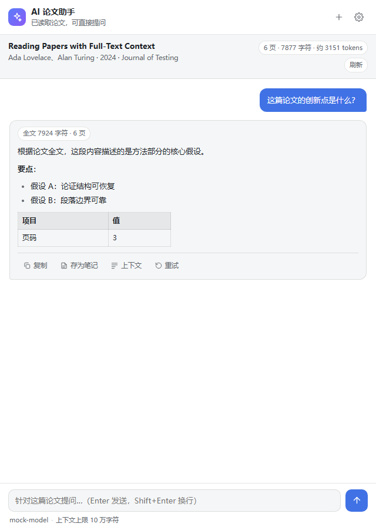

# AI 论文助手（Zotero Ask AI）

一个 Zotero 插件：**在 PDF 阅读器中选中论文内容，一键让 AI 基于论文全文回答问题。**

AI 会先读取整篇论文的正文，再回答你针对选中内容（或整篇论文）的提问，并在回答中给出可核查的**页码引用**。



---

## 功能特性

- **选中即问**：在 PDF 阅读器里选中文字，弹出的工具栏里出现「✨ 问 AI」按钮，点一下即在**阅读器右侧侧栏**提问（不弹独立窗口）。
- **阅读器侧栏面板**：PDF 阅读器工具栏的「AI」按钮可随时打开/收起侧栏聊天，边看论文边问。
- **用量显示**：每条回答下方显示输入/输出 token，以及缓存命中 / 未命中 tokens（DeepSeek 等支持时），方便判断成本。
- **AI 通读全文**：通过 Zotero 内置的 PDF 解析器提取论文全文，拼入系统提示词再提问，而不是只给一段摘录。
- **超长论文自动降级**：论文全文超过「最大上下文字符数」时，自动切换为检索模式（BM25，中英混合分词），只发送与问题最相关的段落，并保留页码。
- **流式回答**：边生成边显示；支持 OpenAI 兼容接口的 SSE 流式输出（含 `reasoning_content` 思考过程展示）。
- **上下文透明化**：每条回答上方显示本次发送的上下文量（全文 N 页 / 检索 N/M 段），点开可查看发送给 AI 的完整论文上下文。
- **多轮对话**：可针对同一篇论文连续追问，历史对话自动带上。
- **一键存为笔记**：把问答（含选中原文、问题、AI 回答）保存为论文的子笔记。
- **思考模式**：支持 DeepSeek 的 thinking（先推理再回答），可切换开关与强度，思考过程折叠显示在回答上方。
- **多种 AI 服务**：预置 DeepSeek、OpenAI、通义千问（百炼）、Moonshot、智谱、硅基流动、Ollama 等，也可自定义任意 OpenAI 兼容端点与请求头。

---

## 工作原理

1. **全文提取**：`Zotero.PDFWorker.getFullText()` 提取 PDF 文本（含 `\f` 分页符），失败时回退到 Zotero 全文索引缓存或纯文本/HTML 附件。
2. **上下文构建**：把全文按页分块；若总字数 ≤ 预算，整篇（带 `【第 N 页】` 标记）放入系统提示词；否则用 BM25 检索与问题最相关的块（中文按单字+二元组分词，英文按词）。
3. **提问**：系统提示词（论文元数据 + 论文全文/摘录 + 学术阅读规则）+ 对话历史 + 当前问题，调用 OpenAI 兼容的 `/chat/completions` 接口。
4. **渲染**：AI 回答以安全的 Markdown 子集渲染（标题、列表、代码块、表格、引用、行内代码、链接），**不会执行模型返回的 HTML**。

---

## 安装

### 方式一：直接安装（推荐）

1. 下载 `dist/zotero-ai-reader-0.2.3.xpi`。
2. 打开 Zotero → `工具 → 插件 → 右上角齿轮 → Install Plugin From File…`，选择该 `.xpi`。
3. 重启 Zotero。

### 方式二：从源码构建

```powershell
# 生成 dist/zotero-ai-reader-0.1.0.xpi
powershell -NoProfile -ExecutionPolicy Bypass -File build/build.ps1
```

> 构建仅需 Windows PowerShell，无第三方依赖。

---

## 配置

首次使用有多个入口：点阅读器里的「✨ 问 AI」、点主窗口工具栏的「AI 助手」、`工具 → AI 论文助手：打开对话窗口`，或直接到 `编辑 → 设置 → AI 论文助手` 面板填写配置。

| 设置项 | 说明 | 默认 |
| --- | --- | --- |
| 服务商预设 | 一键填入常用服务商 | DeepSeek |
| 接口地址 | base URL 或完整的 `/chat/completions` 地址 | `https://api.deepseek.com` |
| API Key | 仅存本机，只发给该接口 | 空 |
| 模型名称 | 例如 `deepseek-flash`、`deepseek-v4-pro`、`gpt-4o-mini` | `deepseek-flash` |
| 思考模式 | 跟随默认 / 开启 / 关闭（DeepSeek 等支持 thinking 的接口） | 跟随默认 |
| 思考强度 | 低 / 高 / 最高（开启思考时生效） | 高 |
| 温度 | 越大越发散，读论文建议 0.2–0.5 | 0.3 |
| 最大上下文字符数 | 全文超过该值改用检索模式 | 100000 |
| 流式输出 / 自动提问 / 回答语言 | 交互行为 | 开 / 关 / 跟随提问语言 |
| 默认问题 | 选中后自动发送的问题 | 见下 |
| 系统提示词（高级） | 留空使用内置学术阅读提示词 | 空 |
| 额外请求头（JSON，高级） | 用于 Azure 等自定义鉴权 | 空 |

默认问题：

> 请结合论文全文，解释我选中的这段内容：它是什么意思、在论文中起什么作用、与上下文和论文核心论点有什么关系？如果涉及公式、实验或数据，请补充必要的背景。

点「测试连接」可立即验证接口与密钥是否正确。

---

## 使用

- **针对选中内容提问**：PDF 阅读器里选中一段文字 → 点「✨ 问 AI」→ 阅读器右侧弹出侧栏面板，输入框上方出现「解释这段 / 起什么作用 / 翻译成中文 / 一句话概括 / 有什么问题」等快捷问题，点一下填入，回车发送。追问继续在侧栏里进行。
- **打开侧栏面板**：PDF 阅读器工具栏的「AI」按钮，随时打开/收起侧栏。
- **针对整篇论文提问**：没有选中内容时，快捷问题变为「总结论文 / 创新点 / 方法 / 局限」；也可在条目上右键「用 AI 阅读这篇论文」。
- **从工具栏打开**：主窗口工具栏新增「AI 助手」按钮；或在 `工具 → AI 论文助手：打开对话窗口`。
- **底部快捷设置**：对话窗口底部一行可直接切换「模型 / 思考模式 / 思考强度」，改完立即生效，无需进设置面板。
- **在设置里配置**：`编辑 → 设置 → AI 论文助手` 面板（接口地址、Key、模型等）。
- **针对整篇论文提问**：条目上右键 →「用 AI 阅读这篇论文」，然后在窗口里直接提问，或点快捷问题（总结 / 创新点 / 方法 / 局限）。
- **从 Tools 菜单打开**：`工具 → AI 论文助手：打开对话窗口`。
- **多轮追问**：在输入框继续提问，回车发送（Shift+Enter 换行）。
- **保存 / 复制**：回答下方的「复制」「存为笔记」按钮。

---

## 兼容性

- 目标版本：Zotero **7.0 – 10.\***（`strict_min_version: "7.0"`）。
- 开发与验证环境：**Zotero 9.0.5**（Gecko/Firefox 140 内核）。所用插件 API（`Zotero.Reader.registerEventListener`、`Zotero.PDFWorker.getFullText`、`Zotero.MenuManager`、插件 `chrome://` 注册、`prefs.js` 默认偏好）均与 Zotero 9 源码逐一核对；窗口/选区按钮/全文提取的写法与已上架插件（PDF Translate、zotero-gpt、Better Notes）一致。
- 更老版本的 Zotero 若缺少 `Zotero.MenuManager`，菜单会静默跳过，但核心的「选中 → 问 AI」功能不受影响。

---

## 测试

```powershell
# 纯逻辑单元测试（分词/分块/检索/SSE/Markdown/提示词/URL 归一化）
node test/core.test.mjs

# UI 端到端测试：用真实浏览器加载插件的真实界面代码，配合模拟的 Zotero/AI 接口
# （覆盖：选区提问、流式回答、Markdown 渲染、上下文查看、设置读写、存笔记、
#   多轮历史、检索模式、错误处理；41 项断言）
# 无头运行见 test/ui/harness.html（需要 Chrome/Edge headless）
```

说明：Zotero 图形界面本身无法在当前无头/受限会话中启动，因此未做「在真实 Zotero 里点按钮」的自动化测试；但插件逻辑与界面代码已通过上述单元测试 + 浏览器端到端测试覆盖，且所有 Zotero 内部 API 调用均针对 9.0.5 源码核对过。

---

## 目录结构

```
zotero-ai-reader/
├── manifest.json            # 插件清单（MV2 + applications.zotero）
├── bootstrap.js             # 生命周期 + chrome://askai/content 注册
├── prefs.js                 # 默认偏好（extensions.zotero.askai.*）
├── chrome/
│   └── content/
│       ├── askai.xhtml      # 聊天窗口外壳（XUL window）
│       ├── scripts/
│       │   ├── core.js      # 纯逻辑：分词/分块/检索/提示词/SSE/Markdown
│       │   ├── plugin.js    # 论文解析、全文提取、选区按钮、菜单、窗口管理
│       │   └── askext.js    # 聊天窗口 UI
│       ├── styles/askai.css
│       └── icons/
├── locale/{zh-CN,en-US}/askai.ftl
├── build/build.ps1          # 打包 .xpi
├── test/
│   ├── core.test.mjs        # 单元测试
│   └── ui/                  # 浏览器 UI 测试与预览
└── dist/                    # 构建产物
```

---

## 隐私与安全

- API Key 保存在本机 Zotero 配置（`extensions.zotero.askai.apiKey`），**只发送到你填写的接口地址**，不会被插件收集或上传到别处。
- 每次提问会把论文全文（或相关摘录）发送给所配置的 AI 服务；请确认你使用的服务符合隐私要求。
- AI 生成的内容可能出错；请以原文为准，必要时点击「上下文」核对页码引用。

---

## 常见问题

**点「问 AI」没反应？** 先确认已在设置里填好接口地址、模型与 API Key，并用「测试连接」验证。

**提示「未能提取到论文全文」？** 该 PDF 可能是扫描版（无文本层）。可先对 PDF 做 OCR（Zotero 支持 `工具 → 识别文档文本`），再重试；插件仍可基于你选中的文字回答。

**超长论文回答不准？** 降低「最大上下文字符数」无济于事（那只会更早进入检索模式）；建议换用上下文窗口更大的模型，或针对具体章节提问。

**接口 401 / 404？** 401 检查 Key；404 检查接口地址（应指向 `…/v1/chat/completions`）。个别服务需要自定义请求头，可用「额外请求头」字段。

**`deepseek-chat` 还能用吗？** 它是 DeepSeek V3.1 时代的旧模型名；官方现在主推 `deepseek-flash`（1M 上下文、支持图像、更便宜）和 `deepseek-v4-pro`（更强）。建议把「模型名称」改成 `deepseek-flash`。

---

## 路线图

- 阅读器侧边栏面板（不弹独立窗口）。
- 阅读器工具栏按钮。
- 上下文检索增强（混合 BM25 + 句子向量）。
- 会话导出为 Markdown/笔记。
- 多窗口、多论文并行会话。
